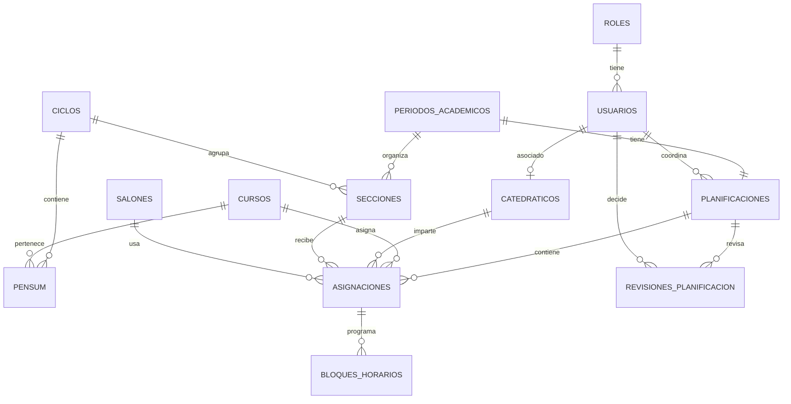

# Base de datos de Planificación de Cursos

El modelo es pequeño y normalizado: los catálogos (`roles`, `ciclos`, `cursos`, `salones`), el pensum, los períodos y secciones alimentan una planificación única por período. `asignaciones` representa la carga académica y `bloques_horarios` permite que una asignación tenga uno o varios días sin duplicar la relación curso-catedrático-sección.

## Modelo entidad-relación



## Ejecución local

Desde una terminal con `psql` disponible:

```bash
psql -U postgres -f database/01_crear_base_datos.sql
psql -U postgres -d planificacion_cursos -f database/schema.sql
psql -U postgres -d planificacion_cursos -f database/seed.sql
psql -U postgres -d planificacion_cursos -f database/04_consultas_prueba.sql
psql -U postgres -d planificacion_cursos -f database/05_pruebas_integridad.sql
```

`01_crear_base_datos.sql` crea la base solamente si no existe. Ningún script elimina tablas o registros.

## Conexión local

```makefile
DB_HOST=localhost
DB_PORT=5432
DB_NAME=planificacion_cursos
DB_USER=postgres
DB_PASSWORD=
```

En el equipo donde se preparó este proyecto, la instancia PostgreSQL activa está
escuchando actualmente en el puerto `5433`; si no se cambia la configuración del
servidor, el backend debe usar `DB_PORT=5433` en lugar de `5432`.

Las cuentas demo se crean con `pgcrypto` y bcrypt. Las tres usan inicialmente `Demo123`; el backend debe exigir cambio o reemplazarlas antes de cualquier uso real.

## Identificación compatible con el backend

- El período se identifica por `periodos_academicos.id_periodo`; la combinación humana estable es única por `(anio, semestre)`.
- La sección se identifica por `secciones.id_seccion`; su contexto completo es `(id_periodo, id_ciclo, nombre)`.
- El ciclo se identifica por `ciclos.id_ciclo` y tiene `numero` único.
- Una asignación se identifica por `asignaciones.id_asignacion` y vincula `id_planificacion`, `id_periodo`, `id_curso`, `id_ciclo`, `id_catedratico`, `id_seccion` e `id_salon`.
- El usuario relacionado con un catedrático se obtiene por `catedraticos.id_usuario -> usuarios.id_usuario`; la relación es opcional para permitir docentes sin cuenta.

## Vistas disponibles

- `v_horarios`: una fila por bloque horario con período, curso, ciclo, sección, docente y salón.
- `v_cursos_asignados`: una fila por asignación, sin repetirla por cada bloque.
- `v_planificaciones_pendientes`: planificaciones en `PENDIENTE_APROBACION`.
- `v_planificaciones_publicadas`: planificaciones en `PUBLICADA`.

## Contrato para Node.js + pg

- Todas las claves son enteros (`integer` o `bigint`); `pg` puede devolver `bigint` como texto según su configuración.
- Las fechas se manejan como `date` y los eventos como `timestamptz`.
- Los estados de planificación son `BORRADOR`, `PENDIENTE_APROBACION`, `APROBADA`, `RECHAZADA` y `PUBLICADA`.
- Los días usan ISO: `1=lunes` a `7=domingo`.
- Para crear una asignación, el backend debe abrir una transacción, bloquear la planificación o el catedrático del período, comprobar carga, sección, salón y traslapes, insertar `asignaciones` y sus `bloques_horarios`, y confirmar.
- El máximo de cuatro cursos se calcula con `count(distinct id_curso)` por `id_periodo` y `id_catedratico`; nunca se deben contar los bloques.
- Las consultas deben usar parámetros (`$1`, `$2`, etc.). Nunca concatenar valores recibidos del usuario.
- `usuarios.password_hash` debe recibir únicamente un hash generado por el backend (por ejemplo, Argon2id o bcrypt). Los scripts iniciales no crean cuentas de acceso.

## Reglas importantes

Las claves foráneas, unicidades y checks protegen la estructura. La validación de flujo de aprobación y el límite de cuatro cursos pertenecen al backend dentro de una transacción. El traslape entre asignaciones requiere un `JOIN` entre `bloques_horarios` y `asignaciones`, por lo que se incluye la consulta parametrizada de detección en `04_consultas_prueba.sql`; bloques consecutivos son válidos porque la condición usa `<` y `>`.
